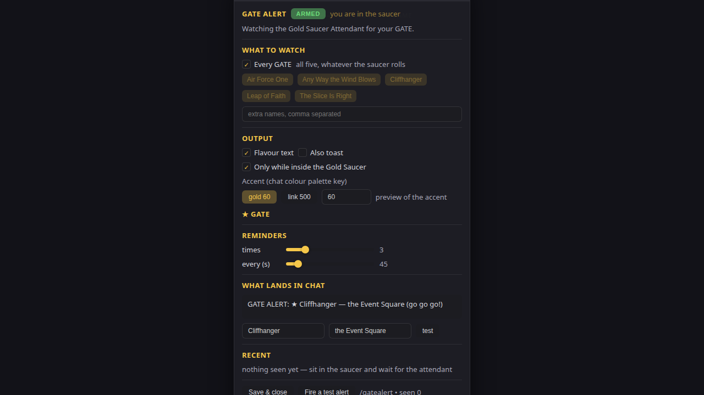
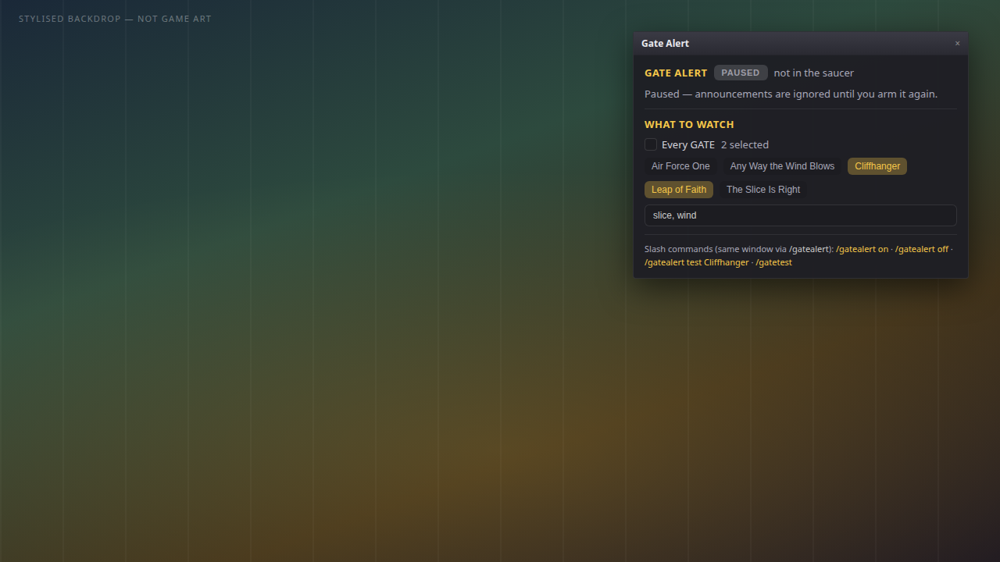
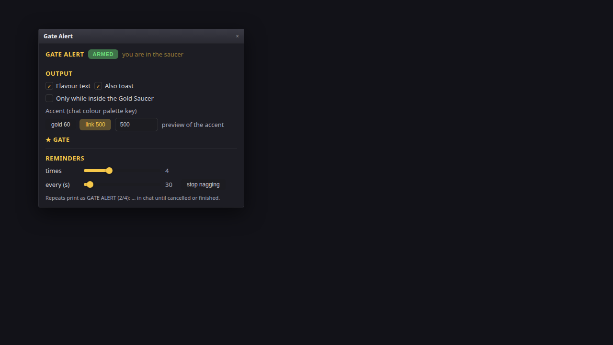
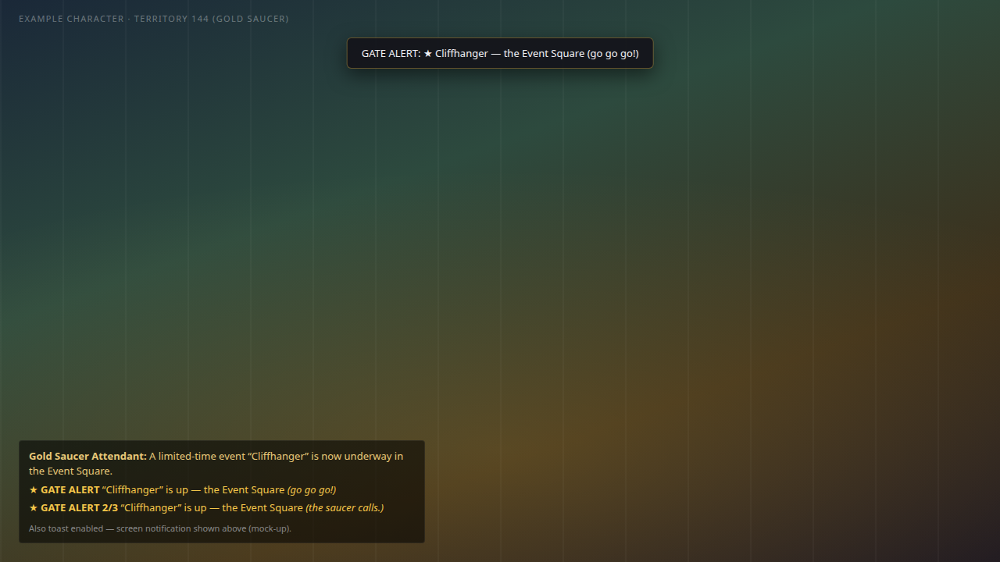
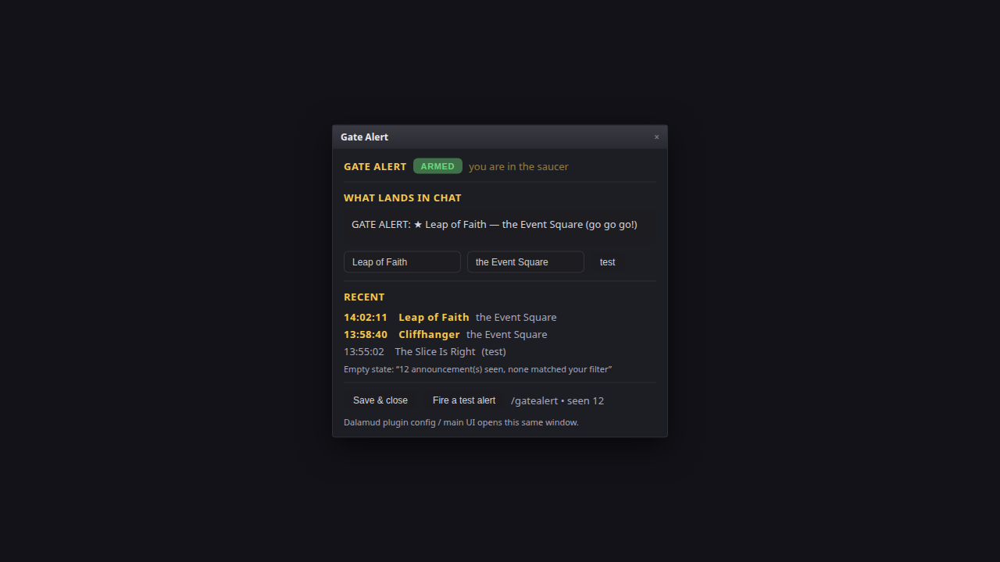

# Gate Alert

A Dalamud plugin that shouts in your chat log when a GATE you watch opens in the Gold Saucer.

`/gatealert` · Dalamud API 15 · .NET 10

## What it does

Prints a starred chat line (and optionally a toast) when a watched GATE opens, and repeats it.

```
★ GATE ALERT  “Cliffhanger” is up — the Event Square  (go go go!)
```

## Screenshots

Screenshots are mock-ups illustrating the UI, not captures from the live game.

| | |
| --- | --- |
|  | **Gate Alert window** — `/gatealert`, ARMED pill, saucer presence, Every GATE, OUTPUT defaults, REMINDERS sliders, live chat preview, empty RECENT, Save & close / Fire a test alert. |
|  | **WHAT TO WATCH** — PAUSED, selective GATE buttons, custom comma list; `/gatealert on`, `off`, `test [name]`, and `/gatetest`. |
|  | **OUTPUT & REMINDERS** — Flavour text, Also toast, territory guard, accent keys (`gold 60`, `link 500`, numeric), repeat sliders, **stop nagging**. |
|  | **Alerts in chat** (and optional toast) — attendant line, starred GATE ALERT, numbered reminders `2/3`. |
|  | **RECENT**, preview **test** button, **Fire a test alert**, `seen` count; Dalamud config/main UI opens the same window. |

### Mock-up video

These clips are mock-ups illustrating the UI, not captures from the live game.


[Download mock-up walkthrough (MP4)](docs/videos/mockup-walkthrough.mp4)

### Feature coverage (every user-facing surface)

| Feature | Shown in |
| --- | --- |
| `/gatealert` — open/close window | 01, 05 |
| `/gatealert on` / `/gatealert off` | 02 |
| `/gatealert test [name]` | 02 |
| `/gatetest [name]` | 02 |
| ARMED / PAUSED master switch (pill) | 01, 02, 03, 05 |
| `you are in the saucer` / `not in the saucer` | 01, 02, 05 |
| Armed vs paused status line | 01, 02 |
| **Every GATE** checkbox | 01 |
| Built-in GATE toggles (five names) | 01 (all, disabled), 02 (subset) |
| Custom list (`extra names, comma separated`) | 01 (empty), 02 |
| **Flavour text** | 01, 03, 04 |
| **Also toast** | 01 (off), 03–04 (on) |
| **Only while inside the Gold Saucer** | 01 (on), 03 (off) |
| Accent palette (`gold 60`, `link 500`, numeric key, preview) | 01, 03 |
| **REMINDERS** — `times`, `every (s)` sliders | 01, 03 |
| **stop nagging** | 03 |
| **WHAT LANDS IN CHAT** live preview | 01, 05 |
| Preview **test** (name + location fields) | 01, 05 |
| **RECENT** history (incl. `(test)`) | 01 (empty), 05 |
| Alternate empty RECENT copy (seen but no match) | 05 (caption) |
| **Save & close** | 01, 05 |
| **Fire a test alert** | 01, 05 |
| Footer `seen` count | 01, 05 |
| Chat alert + reminder index output | 04 |
| Screen toast when enabled | 04 |
| Dalamud **Open Config** / **Open Main UI** → same window | 05 (caption) |

## How it works

The attendant announces each GATE in chat:

> A limited-time event “Cliffhanger” is now underway in the Event Square.

`GateAlert.Core.GateAnnouncementParser` needs the sender to be exactly the Gold Saucer Attendant (case-insensitive), pulls the quoted name, takes the location from the tail ("in …"), and accepts the line only when it carries an announcement marker (*limited-time event*, *is now underway*) **or** names a GATE it knows. Player chat copying the wording is ignored, as is other attendant small talk (Prize Claim counters, the GATE Keeper).

Five are built in: Air Force One, Any Way the Wind Blows, Cliffhanger, Leap of Faith, The Slice Is Right. The custom list adds more, and the same GATE inside 10 s is not shouted twice.

## Commands

| Command | Effect |
| --- | --- |
| `/gatealert` | Open/close the window |
| `/gatealert on` / `off` | Arm or pause |
| `/gatealert test [name]` | Fire a test alert through the real output path |
| `/gatetest [name]` | Same, shorter |

Test alerts bypass the filters on purpose, so you can check the chat line without waiting for a GATE.

## Settings

- **Armed / Paused** — master switch.
- **What to watch** — `Every GATE` (default), any of the five, plus a custom list (comma separated, case-insensitive substring of 3+ characters: `leap` catches Leap of Faith; shorter tokens ignored).
- **Output** — flavour text; toast (off by default: chat is the output); Gold Saucer-only guard (territory 144); accent colour key (60 = Dalamud's yellow sample, 500 = the link colour, any key accepted).
- **Reminders** — chat lines per alert (default 3) and seconds apart (default 45).
- **Live preview** — the exact line it prints.
- **Recent** — last detections, `(test)` when fired by hand.

## Build

Requires the .NET 10 SDK and the Dalamud dev distribution (`%APPDATA%\XIVLauncher\addon\Hooks\dev`).

```
dotnet build GateAlert/GateAlert.csproj -c Release
```

Output: `GateAlert/bin/Release/GateAlert.dll`, with the plugin zip in `GateAlert/bin/Release/GateAlert/latest.zip`.

## Install (dev plugin)

1. `/xlsettings` → Experimental → Dev Plugin Locations → add `GateAlert/bin/Debug/GateAlert.dll` (from `dotnet build GateAlert/GateAlert.csproj -c Debug`).
2. `/xlplugins` → Dev Tools → enable **Gate Alert**.
3. `/gatealert` opens the window; hot reload works, so rebuild while the game runs.

## Tests

The parser and matcher are Dalamud-free, so they run outside the game:

```
dotnet run --project GateAlert.Tests
# 40 passed, 0 failed
```

Covers the announcement shapes, player-spoof rejection, the noise that must be ignored, and the watch/matching rules.

## Limits

- An announcement is a chat line, so an alert only fires while the client receives it — in practice inside the Gold Saucer; the territory-144 guard is extra belt-and-braces.
- Matching assumes the English wording. Other languages use the same shape with different phrases: the sender check plus known names should still catch the five built-ins — not verified — and the custom list is the escape hatch.

## Layout

```
GateAlert/Core/GateAnnouncement.cs  parser + matcher
GateAlert/Core/GateCatalog.cs       five GATEs, sender, territory 144
GateAlert/Core/GateWatcher.cs       chat hook, 10 s duplicate window, repeats
GateAlert/Core/GateAnnouncer.cs     chat line + toast
GateAlert/Configuration.cs          IPluginConfiguration
GateAlert/Windows/ConfigWindow.cs   the window
GateAlert/Plugin.cs                 services, commands
GateAlert.Tests/Program.cs          offline harness
```
