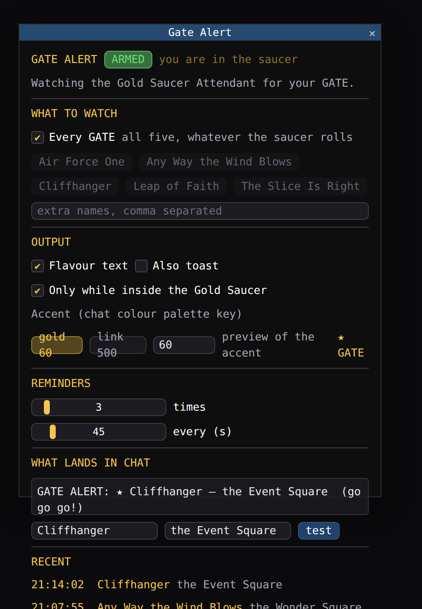
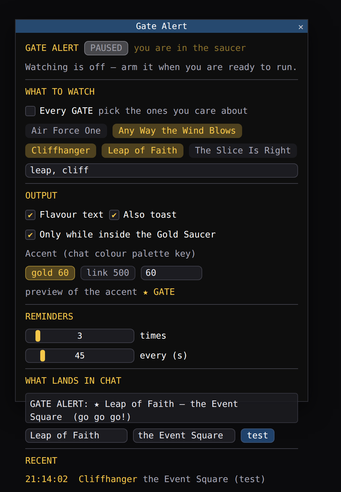
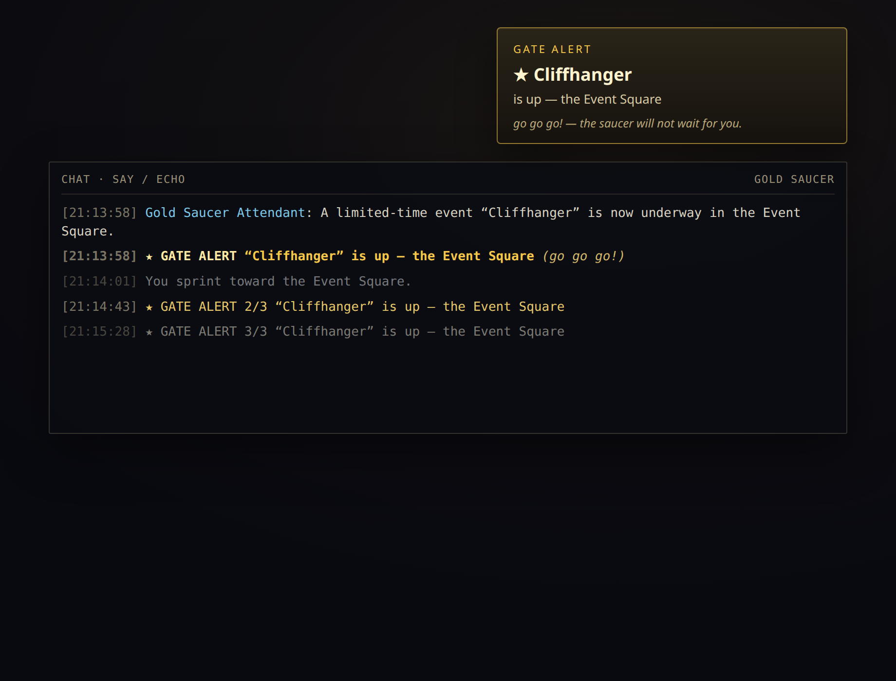
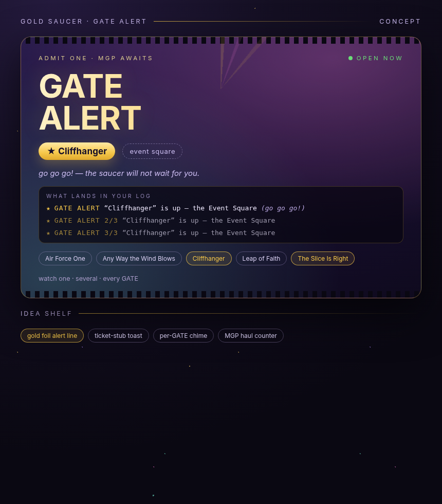

# Gate Alert

A Dalamud plugin that watches the Gold Saucer Attendant's chat line and shouts in your chat log the
moment a GATE you care about goes live. Watch one GATE, several, or every GATE in the saucer.

```
★ GATE ALERT  “Cliffhanger” is up — the Event Square  (go go go!)
```

## Screenshots

Simulated mocks of the shipping ImGui window and what the alert looks like in chat.
HTML sources live under [`docs/mockups/`](docs/mockups/); PNGs under [`docs/screenshots/`](docs/screenshots/).

| Armed (every GATE) | Paused (selective) |
| --- | --- |
|  |  |





## How it detects a GATE

The Gold Saucer Attendant announces each GATE in chat, roughly:

> A limited-time event “Cliffhanger” is now underway in the Event Square.

`GateAlert.Core.GateAnnouncementParser` reads that line: it requires the sender to be exactly the
Gold Saucer Attendant (case-insensitive), pulls the quoted GATE name out, takes the location from
the tail ("in …"), and accepts the line only when it looks like an announcement (a marker phrase
such as *limited-time event* / *is now underway*) **or** when the name is a GATE the plugin knows
about. Player chat that copies the wording is ignored. Other attendant small talk — “Prize Claim”
counters, the GATE Keeper — is ignored.

The five GATEs it knows: Air Force One, Any Way the Wind Blows, Cliffhanger, Leap of Faith,
The Slice Is Right. Anything else can be added by typing its name into the custom list.

## Configuration

The window (`/gatealert`) has:

- **Armed / Paused** — master switch.
- **What to watch** — `Every GATE` (default), or tick any combination of the five; plus a custom
  name list (comma separated, matched as a case-insensitive substring of at least 3 characters,
  so `leap` catches Leap of Faith; shorter tokens are ignored).
- **Output** — flavour text, optional screen toast (off by default: chat is the output), the
  "only while inside the Gold Saucer" guard (territory 144), and the accent colour key.
- **Reminders** — how many chat lines an alert produces (default 3) and how far apart (default 45 s),
  so the first line is not the only chance to notice.
- **Live preview** — the exact line the plugin prints.
- **Recent** — the last few detections, marked `(test)` when you fired them yourself.

## Commands

| Command | Effect |
| --- | --- |
| `/gatealert` | Open/close the window |
| `/gatealert on` / `off` | Arm or pause |
| `/gatealert test [name]` | Fire a test alert through the real output path |
| `/gatetest [name]` | Same, shorter |

Test alerts bypass the filters on purpose, so you can check the chat line without waiting for a GATE.

## Build

```
dotnet build -c Release
```

Needs the .NET 10 SDK and the Dalamud dev distribution (`%AppData%\XIVLauncher\addon\Hooks\dev`).
Output: `GateAlert/bin/Release/GateAlert/`.

To run it: `/xlsettings` → Experimental → Dev Plugin Locations → add
`D:\XIVPlugins Self\GateAlert\GateAlert\bin\Debug\GateAlert.dll`, then enable **Gate Alert** under
`/xlplugins` → Dev Tools. Hot reload works, so rebuild while the game is running.

## Tests

The parser and matcher are Dalamud-free, so they run outside the game:

```
dotnet run --project GateAlert.Tests
```

Checks over the announcement shapes, player-spoof rejection, the noise that must be ignored, and
the watch/matching rules.

## Notes and limits

- The announcement is a chat line, so the plugin only ever fires while the client is receiving it —
  which is inside the Gold Saucer. The "only inside the Gold Saucer" guard is a belt-and-braces extra.
- Matching is written against the English wording. Other client languages announce GATEs with the
  same shape but different phrases; the sender check plus the known-name path still catches the five
  built-in GATEs there, but the custom list is the escape hatch for anything else.
- The accent uses the chat colour palette key (60 = the yellow Dalamud's own sample uses, 500 = the
  link colour); any key is accepted in the box next to the presets.
- `mockup.html` is a faithful mock of the window; `concept.html` is the flair direction, not the
  shipping UI. Extra state mocks and rendered PNGs are under `docs/mockups/` and `docs/screenshots/`.